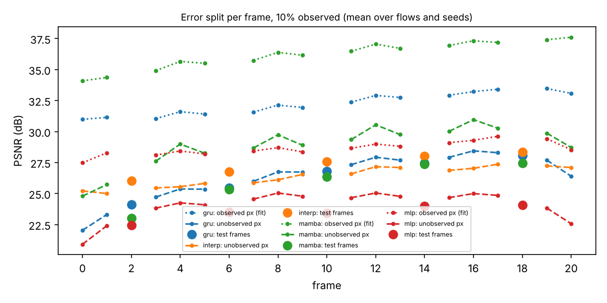
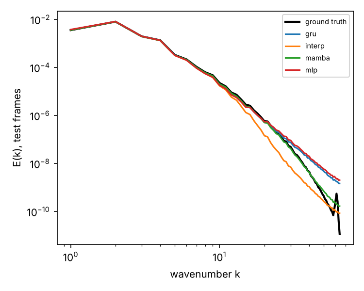

# Step 1: Mamba vs MLP vs GRU with the same smoothness term

Criterion (fixed in advance): Mamba wins if its test PSNR is >= 1.0 dB higher than both the MLP and the GRU (mean over 5 flows x 3 seeds) and the 95% CI of each paired difference is above 0.

## Smoothness weight, chosen on validation frames (mean validation PSNR, dB)

|   temporal_reg |   gru |   mamba |   mlp |
|---------------:|------:|--------:|------:|
|            0   | 25.24 |   22.26 | 22.91 |
|            0.3 | 25.8  |   25.32 | 23.16 |
|            1   | 25.58 |   25.39 | 22.82 |
|            3   | 25.04 |   25.18 | 22.67 |

Chosen: gru λ=0.3, mamba λ=1.0, mlp λ=0.3

## Final runs, 10% observed (PSNR dB; test = 5 never-observed frames)

| model   |   λ |   net params |   runs |   test PSNR |   SD across flows |   SD across seeds |   observed px |   unobserved px |   spectrum log err |   enstrophy ratio |   min/run |
|:--------|----:|-------------:|-------:|------------:|------------------:|------------------:|--------------:|----------------:|-------------------:|------------------:|----------:|
| gru     | 0.3 |        68913 |     15 |      26.38  |             1.532 |             0.543 |        32.253 |          26.378 |              0.072 |             0.98  |     3.76  |
| interp  | 0   |            0 |      5 |      27.356 |             0.885 |           nan     |       126.021 |          26.38  |              0.421 |             0.929 |     0.013 |
| mamba   | 1   |        69062 |     15 |      25.915 |             0.96  |             0.271 |        36.222 |          28.891 |              0.046 |             0.979 |    36.729 |
| mlp     | 0.3 |        69131 |     15 |      23.496 |             1.076 |             0.511 |        28.655 |          24.084 |              0.103 |             0.977 |     3.093 |

Parameter match vs Mamba: mlp +0.1%, gru -0.2% (tolerance ±10%)

## Paired differences (seed-averaged per flow)

- Mamba − MLP: +2.42 dB, 95% CI [+1.61, +3.23] over 5 flows (per flow: +1.53, +2.22, +2.53, +3.36, +2.47) → meets the criterion
- Mamba − GRU: -0.46 dB, 95% CI [-1.73, +0.80] over 5 flows (per flow: -1.76, -0.31, -0.02, +0.89, -1.12) → does not meet the criterion

Seeds per model: {'gru': 3, 'mamba': 3, 'mlp': 3}

**Verdict: Mamba does not win.**

## Ceiling: fully observed (100% of pixels in training frames)

| deform   |   heldout_frames_psnr |   train_frames_psnr |
|:---------|----------------------:|--------------------:|
| gru      |                 33.27 |               34.39 |
| interp   |                 34.04 |              126.02 |
| mamba    |                 27.89 |               35.79 |
| mlp      |                 28.96 |               31.65 |

